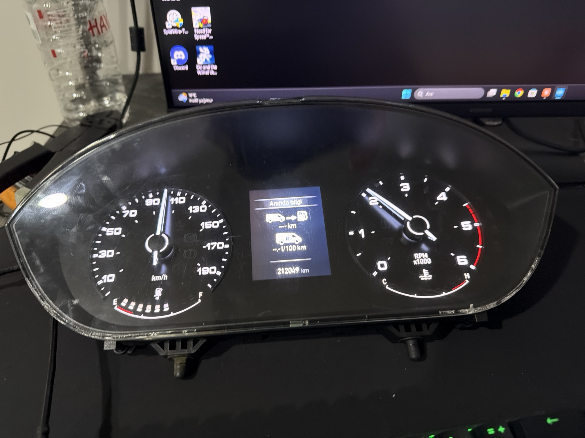

# Fiat Ducato 2023 CAN Dashboard

I'm reverse-engineering the instrument cluster from a 2023 Ducato on my bench, so I can drive it from a computer and from ETS2 / BeamNG, like my [2009 X250 project](https://github.com/tnsozcan/ducato-x250-can-dashboard).

[Turkish setup](docs/KURULUM_TR.md) | [CAN messages](docs/CAN_MESSAGES.md)



## Status

| Gauge / function | Status |
|---|---|
| RPM needle | ✅ 0FC |
| Speed needle | ✅ 101 |
| Fuel bar (9 segments) | ✅ 545 |
| Illumination (bright / dim) | ✅ 545 |
| ABS / ESC / traction / Hill Hold messages | ✅ 4AF |
| Airbag and seatbelt lamps | ✅ 257 |
| Engine warning lamp | ✅ 226 (off), 5AE b4 10 (on) |
| Glow plug, red coolant, fuel filter, oil service | ✅ 5AE |
| Doors, bonnet, immobilizer, start-stop | ✅ 356 (125k bus) |
| **Coolant temperature bar** | ❌ not found yet |
| Parking brake, turn signals, headlights, cruise | ❌ not found yet (probably 125k body bus) |

## What is different from the X250

The 2009 X250 cluster lives on a single 50 kbit/s body CAN and is woken by one message (380). The 2023 cluster sits on **two** buses:

- **125 kbit/s body CAN** on pins 5 (L) / 6 (H), same positions as the X250
- **500 kbit/s CAN** on pins 11/12 (L) and 13/14 (H), where RPM, speed and fuel are

Pinout I measured on my cluster: 1 GND, 2 +12 V, 3 +12 V ignition, 5/6 125k CAN L/H, 11+12 500k CAN-L, 13+14 500k CAN-H, 15 5 V output, 16 GND; 7 and 8 unknown; 4, 9, 10, 17, 18 empty.

None of the X250 IDs work. On the new cluster, **0FC** (RPM frame) plays part of the role of the old 380: its b6 must be set, otherwise the RPM needle stays asleep. The speed needle wakes up from 101 alone.

## Hardware

Same as the X250 project: Arduino Nano ATmega328P + MCP2515 (**8 MHz crystal**) + TJA1050.
CS D10, INT D2, MOSI D11, MISO D12, SCK D13. Serial 115200. Library: **mcp_can by Cory J. Fowler, 1.5.1**.

Bench only, with the cluster removed from the vehicle. The tools here transmit on the bus; do not connect them to a car.

## Quick start

1. Upload `firmware/Gosterge_Bench/Gosterge_Bench.ino` (Arduino Nano / ATmega328P). This is the bench / reverse-engineering tool; for games see the next section.
2. Connect the module to the cluster's 500 kbit/s pins. I used **12 (CAN-L) and 13 (CAN-H)**; 11 and 14 are the same bus (11-12 and 13-14 measure ~0 Ω, connected inside the cluster).
3. Open Serial Monitor at 115200 with "Newline" and paste:

```
rate 500
rep 0FC 50 20 40 00 00 00 00 FF 00
rep 101 100 00 C8 00 00 00 00 00 00
rep 545 100 00 00 08 00 00 00 00 00
rep 0DE 100 FF FF FF FF FF FF FF FF
rep 4AF 100 00 80 00 00 00 00 00 00
rep 257 100 20 00 00 00 00 00 00 00
rep 5AE 100 00 00 00 00 00 00 00 00
rep 226 100 00 00 00 00 00 00 00 00
```

The cluster shows 2000 RPM, about 100 km/h, 6/9 fuel and no warning lamps. Change a value live, for example `byte 0FC 0 30` for 3000 RPM or `byte 101 1 64` for 50 km/h.

The Nano resets every time Serial Monitor opens and starts at 125 kbit/s, so type `rate 500` first.

## Play ETS2 / BeamNG

`firmware/Ducato2023_Game/Ducato2023_Game.ino` understands the same `game ...` packets as the X250 project, so the PC bridges are unchanged (copied here in `bridge/`, `ETS2.cmd`, `BeamNG.cmd`, `beamng_mod/`).

1. Upload `Ducato2023_Game.ino`, connect the module to the **500 kbit/s** pair, close Serial Monitor.
2. `py -m pip install -r requirements.txt`
3. Follow the ETS2 (Funbit telemetry server) or BeamNG (custom protocol mod) steps from the [X250 README](https://github.com/tnsozcan/ducato-x250-can-dashboard#ets2), then run `ETS2.cmd COM5` or `BeamNG.cmd COM5`.

Driven from the game: RPM, speed, fuel, illumination (dims with parking/low beam), red coolant lamp above 110 °C. BeamNG also drives traction-control flashing, seatbelt, airbag flashing, engine fault and water-in-fuel lamps. Steering, ABS/ESC, airbag and engine-module frames are sent continuously so their warning lamps stay off. Not yet: coolant bar, parking brake, turn signals, headlight symbols, cruise.

Ignition on in the game starts an X250-style lamp check: ABS, brake and traction lamps for about 5 s (4AF stopped), the glow plug lamp for 2/3/5/7 s depending on engine temperature, the engine lamp until 2 s after the engine starts (0FC b6 is held at 00 while the engine is off, so the RPM needle wakes up on start). Ignition off, or no packet for 1 s, brings the needles down to zero for 1.5 s, then the firmware stops transmitting and the cluster goes to sleep.

## Known issues and limits

- **Tested with ETS2 only.** The BeamNG path uses the same bridge and packet, but has not been run against this cluster yet.
- **Coolant temperature bar** not found. Parking brake, turn signals, headlight symbols and cruise not found either; they are probably on the 125k body bus, which this single-controller setup does not drive (doors, bonnet and immobilizer live there too).
- **Speed** is converted back from the X250 bridge calibration; the needle can be a few km/h off at some speeds.
- **Fuel** never shows fewer than 3 of 9 segments (b2 = 00/01 both show 3).
- **ABS/brake/traction lamp check** is done by stopping 4AF, so the cluster lights them after its own timeout (~1 s late) and they all go off together. `LAMP_DELAY_MS` delays the glow and engine lamps to line them up; tune it for your cluster.
- While the engine is off, 0FC b6 is sent as 00, so the RPM needle stays asleep until the engine starts (the speed needle runs from 101 and sits at 0). The battery lamp was not found.
- **0FC b6**: the exact value needed is unknown; `FF` works, no single bit does.
- Gosterge_Bench starts at 125 kbit/s after every reset (opening Serial Monitor resets the Nano).
- The Nano code has been compiled and run on my bench only.

## Gosterge_Bench commands

| Command | What it does |
|---|---|
| `send ID b0 b1 ...` | Send one frame |
| `rep ID ms b0 b1 ...` | Send repeatedly (8 slots; same ID updates) |
| `byte ID n value` | Change one byte of a repeating frame |
| `unrep ID` / `stop` | Stop one / all repeats |
| `ids`, `clear`, `mon` | Frames received from the cluster, reset, live view |
| `rate 500/250/125/100/50` | Bus speed |
| `stat` | Error counters and active repeats |
| `scan`, `qscan` | Walk 11-bit IDs with fixed data (keeps repeats running) |
| `xscan` | Walk 29-bit IDs with a step |
| `bits ID ms [base]` | Flip one bit at a time (`ms` = 0 for manual `n` / `p`) |
| `bytes ID n ms [base]` | Try all 256 values of one byte |
| `m note` / `marks` | Mark the current step during any scan / list marks |

## How it was found

Mostly by scanning: sending fixed data (`FF`, `82`, `80`, `C0`) to every ID while watching the cluster, marking reactions, then narrowing down with single `rep` frames and bit/byte scans. A key lesson: send continuously (every 50-100 ms) and keep the other known frames running while scanning, because some reactions only appear in combination (for example, the red brake lamp goes off only when 4AF and 101 are both sent).

## License

MIT
